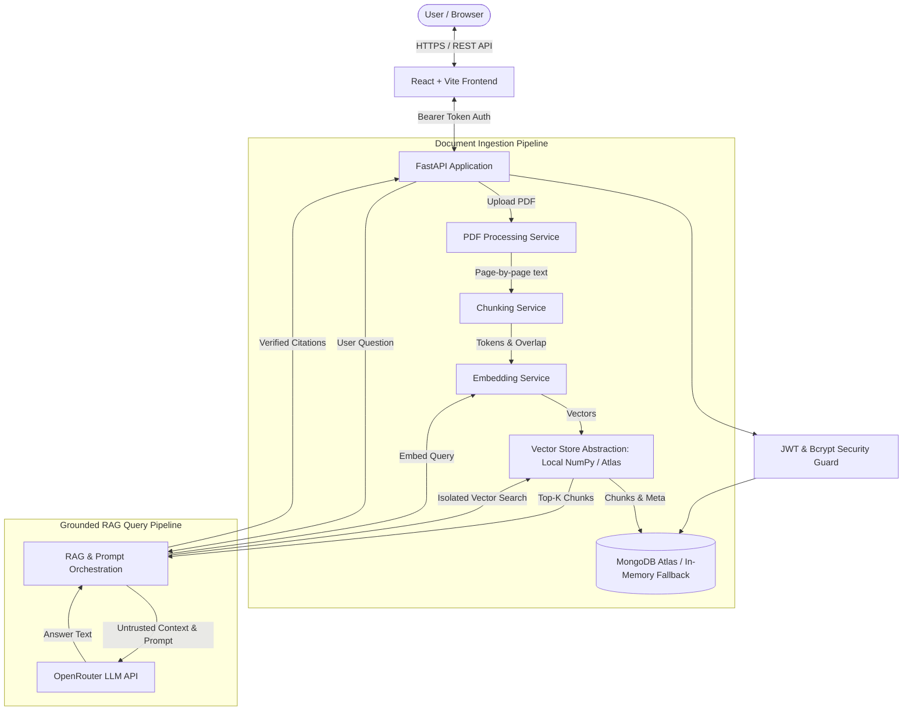

# Architecture Documentation — Intelligent RAG Chatbot

## 1. System Overview

**Intelligent RAG Chatbot** is a production-minded, full-stack AI application designed to index PDF documents and deliver natural language answers strictly grounded in document contents with verifiable source citations (filename, page number, and chunk excerpts).

---

## 2. Component Architecture

### 2.1 Backend (`FastAPI`)
- **`app/api/auth.py`**: User registration, login, and `/auth/me` profile endpoint. Passwords hashed using bcrypt (12 rounds). Signs and decodes HS256 JWT tokens.
- **`app/api/documents.py`**: PDF upload validation, page-by-page text extraction, duplicate SHA-256 detection, chunking, embedding, status tracking, and deletion.
- **`app/api/conversations.py`**: Thread management, message persistence, and RAG execution.
- **`app/api/health.py`**: `/health` (liveness probe) and `/ready` (readiness probe detailing DB, vector store, embedding provider, and LLM configuration without secret leakage).

### 2.2 Security & Multi-Tenant Isolation
- **Resource Ownership**: Every document, chunk, conversation, and message carries an `owner_id`.
- **Vector Search Isolation**: Vector queries mandate an `owner_id` filter clause. Cross-user vector retrieval is strictly impossible.
- **Storage Protection**: Uploaded PDFs are stored using UUIDv4 filenames outside the public static directory.

### 2.3 Document Ingestion Pipeline
1. **Validation**: Enforces `.pdf` extension, max file size (10 MB), `%PDF-` magic bytes, `pypdf` structural validation, and encryption check.
2. **Scanned PDF / OCR Detection**: Detects PDFs with no extractable text and returns a clear explanation that OCR is required rather than silent failure.
3. **Chunking**: Splits pages into cohesive chunks of ~800 tokens (~3200 characters) with ~100 tokens (~400 characters) overlap, preserving page references and document IDs.
4. **Embeddings**: Uses dedicated embedding models (via OpenRouter or OpenAI) with a deterministic mock fallback for offline tests.
5. **Vector Indexing**: Indexed in `LocalVectorStore` (NumPy cosine similarity) or `MongoAtlasVectorStore` ($vectorSearch).

### 2.4 RAG & Question-Answering Pipeline
1. **Query Embedding**: The user's question is embedded using the dedicated embedding service.
2. **Scoped Retrieval**: Filters search strictly to the authenticated user and optionally specified document IDs.
3. **Untrusted Context Boundary**: Injects chunks wrapped in `<untrusted_document_context>` delimiters to protect against prompt injection embedded in documents.
4. **Deterministic Citation Verification**: Citations returned by the API are reconstructed directly from the actual retrieved chunks, guaranteeing that page numbers, filenames, and excerpts are strictly factual.
